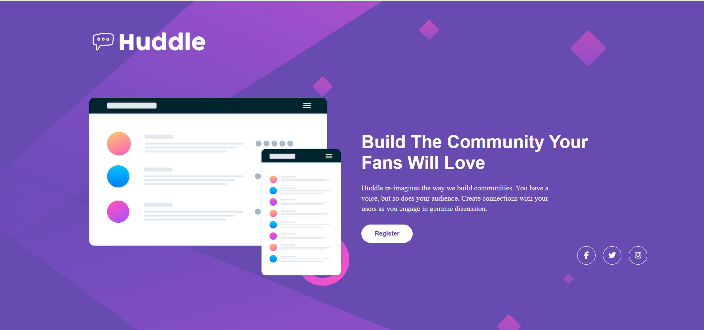

# Huddle Landing Page

> Mobile-first Frontend Mentor UI challenge built with HTML, CSS, and vanilla JavaScript.

## 📸 Preview

| Desktop Version | Mobile Version |
|----------------|----------------|
|  |  |

## 🛠️ Built with

- HTML5
- CSS3 (Flexbox, Grid, Media Queries)
- Vanilla JavaScript for the registration demo

*** 

## 🚀 Live Demo

[Open Huddle Landing Page](https://golu-dhama.github.io/huddle-landing-page/)

Select **Register** and enter a sample email to test the in-browser form.

## 📱 Responsive breakpoints

- Mobile: up to 768px
- Desktop: 768px and above

## ✅ What I practiced

- Design deconstruction (pehle boxes, phir flex/grid)
- Mobile-first workflow
- Hover effects and transitions

## 🙏 Credit

Design inspiration – Frontend Mentor (Huddle challenge)

---

Made with ❤️ by [Azad Dhama]
